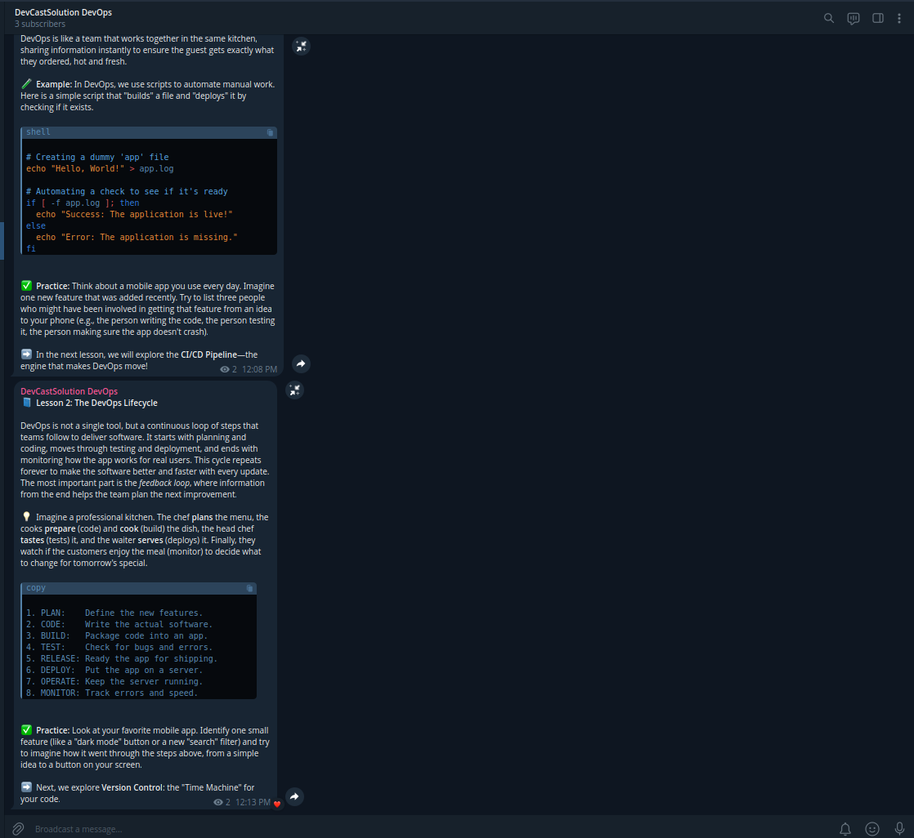
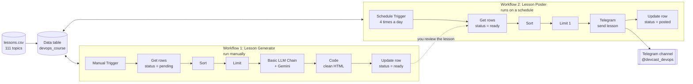
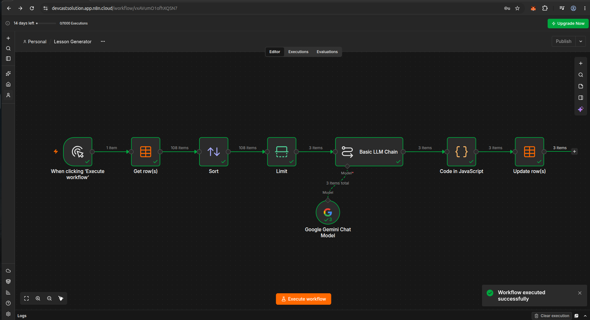
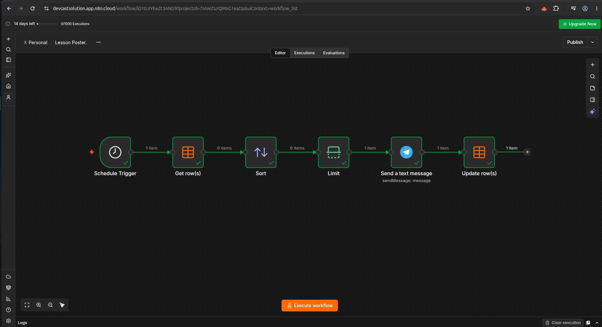

# DevOps Course Telegram Bot

> A complete beginner-to-job-ready **DevOps course, taught on Telegram and run entirely by automation.**
> AI writes the lessons, a human reviews them, and n8n posts 4 lessons a day, hands-free.

[](https://n8n.io)
[](https://t.me/devcast_devops)
[](https://aistudio.google.com)

**Live channel: [t.me/devcast_devops](https://t.me/devcast_devops)** (DevCastSolution DevOps)



---

## Table of contents

1. [What this project does](#what-this-project-does)
2. [The course](#the-course)
3. [How it works](#how-it-works)
4. [The two workflows](#the-two-workflows)
5. [Project structure](#project-structure)
6. [Setup on n8n Cloud (no Docker)](#setup-on-n8n-cloud-no-docker)
7. [Daily routine](#daily-routine)
8. [Prompt design](#prompt-design)
9. [Troubleshooting](#troubleshooting)
10. [Roadmap](#roadmap)

---

## What this project does

- Teaches **111 lessons** covering Linux, Git, Docker, CI/CD, AWS, Terraform, Kubernetes and more
- Posts **4 lessons per day** (08:00, 12:00, 16:00, 20:00), finishing the course in about **28 days**
- Uses **Google Gemini** to write each lesson from a fixed curriculum, so order and quality stay consistent
- Keeps a **human review step** between AI writing and posting, because AI can get commands wrong
- Runs **fully hosted on n8n Cloud**: no server, no Docker, nothing running on your own computer

## The course

15 modules, 111 lessons. Every lesson has the same format: a short explanation, a real-world analogy, a tested example, a practice task and a teaser for the next lesson.

| # | Module | Lessons |
|---|--------|---------|
| 1 | DevOps basics and mindset | 4 |
| 2 | Linux essentials | 10 |
| 3 | Networking basics | 6 |
| 4 | Git and GitHub | 8 |
| 5 | Bash scripting | 6 |
| 6 | Docker | 12 |
| 7 | Docker Compose | 5 |
| 8 | CI/CD with GitHub Actions | 8 |
| 9 | Cloud basics with AWS | 10 |
| 10 | Infrastructure as Code with Terraform | 8 |
| 11 | Configuration management with Ansible | 5 |
| 12 | Kubernetes | 14 |
| 13 | Monitoring and logging | 6 |
| 14 | DevSecOps | 5 |
| 15 | Capstone project | 4 |

The full list with key points per lesson is in [CURRICULUM.md](CURRICULUM.md).

## How it works

Two workflows share one n8n **Data table** called `devops_course`. They are not wired together. They cooperate through the `status` column.



### Lesson status

| Status | Meaning | Changed by |
|---|---|---|
| `pending` | Topic exists, no lesson written yet | Starting value from `lessons.csv` |
| `ready` | AI wrote the lesson, waiting to be posted | Lesson Generator |
| `posted` | Lesson was sent to Telegram | Lesson Poster |

To rewrite a lesson, edit its `content` cell directly, or set its `status` back to `pending` and run the generator again.

### Data table: `devops_course`

| Column | Description |
|---|---|
| `lesson_no` | `001` to `111`, controls the posting order |
| `module` | Module name |
| `topic` | Lesson title |
| `outline` | Key points the AI must cover |
| `content` | Final Telegram message (Telegram HTML) |
| `status` | `pending`, `ready` or `posted` |

## The two workflows

### Workflow 1: Lesson Generator (manual)

Run it whenever you need more lessons. Each run writes a few lessons, then you review them.



| # | Node | Purpose |
|---|------|---------|
| 1 | Manual Trigger | You start it by clicking **Execute workflow** |
| 2 | Data table: Get row(s) | Reads lessons where `status = pending` |
| 3 | Sort | Orders by `lesson_no`, ascending |
| 4 | Limit | How many lessons to write per run (3 to test, 10 for normal use) |
| 5 | Basic LLM Chain + Google Gemini Chat Model | Writes the lesson from topic and key points |
| 6 | Code in JavaScript | Escapes text, keeps only Telegram-safe HTML tags, trims to 3900 characters |
| 7 | Data table: Update row(s) | Saves `content` and sets `status = ready` |

### Workflow 2: Lesson Poster (scheduled)

Runs on its own, 4 times a day, and posts the next ready lesson.



| # | Node | Purpose |
|---|------|---------|
| 1 | Schedule Trigger | Cron `0 8,12,16,20 * * *` |
| 2 | Data table: Get row(s) | Reads lessons where `status = ready` |
| 3 | Sort | Orders by `lesson_no`, ascending |
| 4 | Limit | Takes only the next 1 lesson |
| 5 | Telegram: Send a text message | Posts `content` to the channel with Parse Mode HTML |
| 6 | Data table: Update row(s) | Sets `status = posted` |

The status update comes **after** Telegram. If sending fails, the lesson is not marked as posted and is retried at the next slot. If no lesson is `ready`, the run does nothing.

## Project structure

```
devops-course-telegram-bot/
├── README.md                          This file
├── CURRICULUM.md                      All 111 lessons, days and posting times
├── .gitignore
├── data/
│   └── lessons.csv                    Import this into the n8n Data table
├── workflows/
│   ├── lesson-generator.json          Workflow 1 (export from n8n)
│   └── lesson-poster.json             Workflow 2 (export from n8n)
└── docs/
    ├── lesson-generator-workflow.png
    ├── lesson-poster-workflow.png
    └── telegram-channel.png
```

## Setup on n8n Cloud (no Docker)

### Requirements

- An [n8n Cloud](https://n8n.io) account (a free trial is available; check n8n's current plans for what happens after the trial)
- A Telegram account
- A Google AI Studio API key for Gemini (check Google's current free-tier terms)

### 1. Create the Telegram bot

1. In Telegram open **@BotFather** and send `/newbot`.
2. Choose a name, then a username ending in `bot`.
3. Copy the **API token** and keep it secret. If it leaks, send `/revoke` to BotFather.

### 2. Create the channel

1. Create a new **public** channel and give it a username (this project uses `@devcast_devops`).
2. Open the channel → **Administrators → Add Administrator**, choose your bot, and enable **Post Messages**.
3. Test the bot in your browser:
   ```
   https://api.telegram.org/bot<YOUR_TOKEN>/sendMessage?chat_id=@devcast_devops&text=Hello
   ```
   A message should appear in the channel.

### 3. Create the credentials in n8n

Open **Personal → Credentials → Create credential** and add:

| Credential | Value |
|---|---|
| **Telegram API** | The bot token from BotFather |
| **Google Gemini(PaLM) Api** | Your Gemini API key |

### 4. Create the Data table

1. Open **Personal → Data tables → Create Data table** and name it `devops_course`.
2. Import `data/lessons.csv`.
3. Confirm there are 111 rows and every `status` is `pending`.

### 5. Import the workflows

For each file in `workflows/`: **Workflows → ⋯ → Import from file**.

After importing, open each workflow and fix these (credentials are never included in exported files):

- **Gemini Chat Model**: select your Gemini credential
- **Telegram node**: select your Telegram credential and set **Chat ID** to your channel, for example `@devcast_devops`
- **Data table nodes**: make sure they point to `devops_course`
- **Lesson Poster → Settings → Timezone**: set your timezone so 08:00 means 08:00 for you

### 6. Generate and review the first lessons

1. Open **Lesson Generator** and click **Execute workflow**.
2. Open **Data tables → devops_course** and read each new `content`. Check every command and fix mistakes.
3. Repeat until you have at least 8 `ready` lessons (2 days of posting).

### 7. Start posting

1. Open **Lesson Poster** and click **Execute workflow** once to test. Lesson 1 appears in your channel and becomes `posted`.
2. Set any test lessons back to `ready` if you want them to be posted again.
3. Click **Publish**. From now on lessons go out at 08:00, 12:00, 16:00 and 20:00.

Only **Lesson Poster** is published. **Lesson Generator** stays manual.

## Daily routine

| When | What you do |
|---|---|
| Every 2 to 3 days | Run **Lesson Generator**, then read the new lessons in the Data table |
| Always | Keep at least 8 `ready` lessons ahead of the poster |
| If a lesson is wrong | Edit `content`, or set `status` to `pending` and regenerate |
| Never | Publish unreviewed lessons: AI-written commands must be checked |

Posting uses 4 workflow executions per day, plus a few manual generator runs. Check your n8n plan for its execution limit.

## Prompt design

The generator uses a fixed system prompt so every lesson looks the same.

**System message**

```
You are a DevOps teacher writing one Telegram lesson for complete beginners.

Rules:
- Total length under 2500 characters.
- Use ONLY these HTML tags: <b>, <i>, <code>, <pre>. No Markdown. No other tags.
- Use exactly this structure:
  1. 📘 <b>Lesson N: Title</b>
  2. A short explanation, 3 to 5 sentences, simple words.
  3. 💡 One real-world analogy.
  4. 🧪 A <pre> block with a small example (commands or config).
  5. ✅ <b>Practice:</b> one small task the student can do now.
  6. ➡️ One line teasing the next topic.
- Only include commands you are certain are correct and safe for a beginner. Never invent flags or options.
- Write in clear English.
```

**User message** (n8n expression)

```
Write lesson {{ Number($json.lesson_no) }} for a beginner DevOps course.

Module: {{ $json.module }}
Topic: {{ $json.topic }}
Points to cover: {{ $json.outline }}
```

**Why the Code node exists:** Telegram's HTML mode rejects unknown tags and unescaped `<`, `>` and `&`. The Code node escapes everything, restores only `<b>`, `<i>`, `<code>` and `<pre>`, converts any Markdown the AI slips in, and trims the text under Telegram's 4096-character limit.

## Troubleshooting

| Problem | Fix |
|---|---|
| `chat not found` | The bot is not a channel administrator, or the Chat ID is wrong |
| `can't parse entities` | Parse Mode must be **HTML**; check the generated `content` for broken tags |
| Poster runs but nothing posts | No row has `status = ready`: run the generator |
| Same lesson posted twice | The Update row node failed or has the wrong condition: check `id` equals `{{ $('Limit').item.json.id }}` |
| Lessons generated out of order | Sort node must use `lesson_no`, ascending |
| Gemini returns an error | Check the API key and the model selected in the Gemini Chat Model node |
| 429 or quota errors | Lower the Limit in the generator and run it again later |

## Roadmap

- [ ] Daily LinkedIn post (one short summary per day, with a link to the channel)
- [ ] Quiz after each module using Telegram polls
- [ ] Amharic version of the course
- [ ] Error workflow that sends an alert when posting fails
- [ ] Course completion certificate for finishers

## Tech stack

n8n Cloud · Telegram Bot API · Google Gemini · n8n Data Tables
